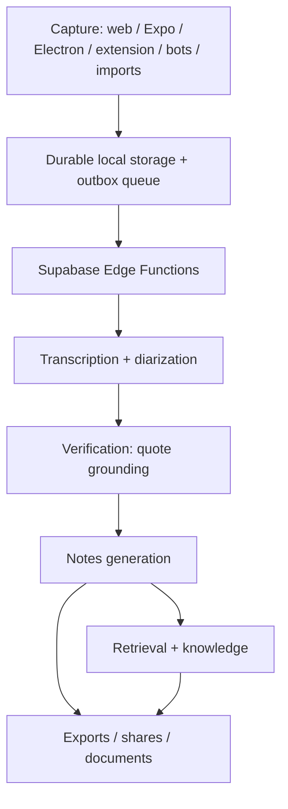

# Architecture Dependency Map

Canonical pipeline and the shared modules that implement each stage.

## Stage → modules

| Stage | Key modules |
|---|---|
| Capture | `desktop/src/renderer/capture.ts`, `src/lib/recorder.ts`, `src/lib/localStt.ts` |
| Local queue | `desktop/src/shared/queue.ts`, `desktop/src/renderer/sync.ts`, `src/lib/sync.ts` |
| Ingestion | `ingest/`, `import_audio.ts`, `ingest.ts` |
| Transcription | `stt.ts`, `mistral.ts`, `services.ts` (Deepgram/Mistral/local) |
| Verification | `verify.ts` (quote grounding, owner mention, key-point/action verification) |
| Notes | `prompts.ts`, `pipeline.ts`, `notes_data.ts`, `share.ts` |
| Evaluation | `coverage.ts`, `semantic.ts`, `faithfulness.ts` |
| Retrieval | `ask/`, `mcp/`, `recall.ts`, `semantic.ts`, `trackers.ts` |
| Documents | `deck_plan.ts`, `deck.ts`, `deck_images.ts`, `pptx_verify.ts`, `docx.ts`, `export_data.ts` |
| Calendar/bots | `calendar.ts`, `calendar_fetch.ts`, `bot_core.ts`, `bot_timing.ts` |

## Shared contracts (reuse, do not duplicate)

- **Transcript:** `transcripts.utterances` JSONB `{text,start_ms,end_ms,speaker}` + `speaker_names`.
- **Summary:** `summaries` with `overview`, `key_points`, `key_point_details`, `decisions`, `detailed_sections`, `conclusions`, `detail_level`, `notes_schema_version`.
- **Evidence:** `verify.ts` `findQuote()` → `quote_ms` + `verified`; every task/decision/key-point carries a grounded quote.

## Notes

- Single relational Postgres (RLS everywhere); no graph/queue/vector service. Advanced phases must extend this schema additively (`note_versions`, `knowledge_*`, etc.).
- The deck/notes work reuses `verify.ts` + `detailed_sections`; do not introduce a parallel notes model.
